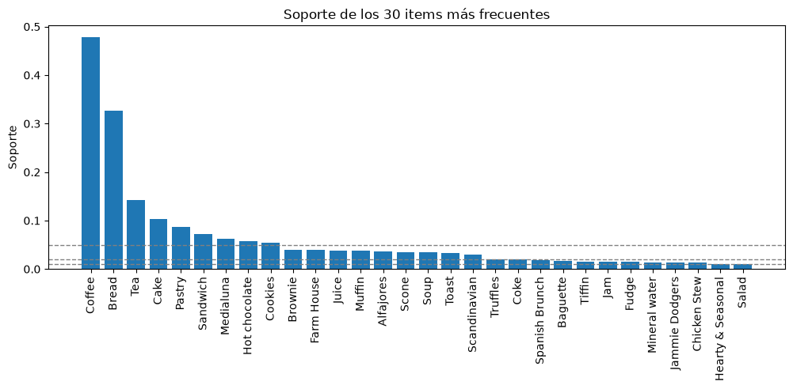
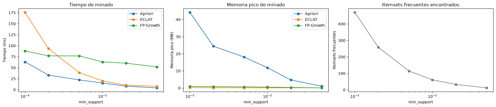
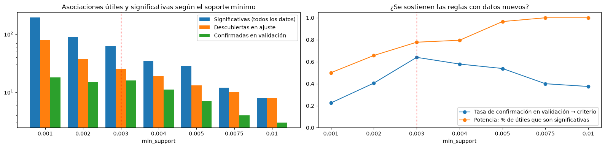
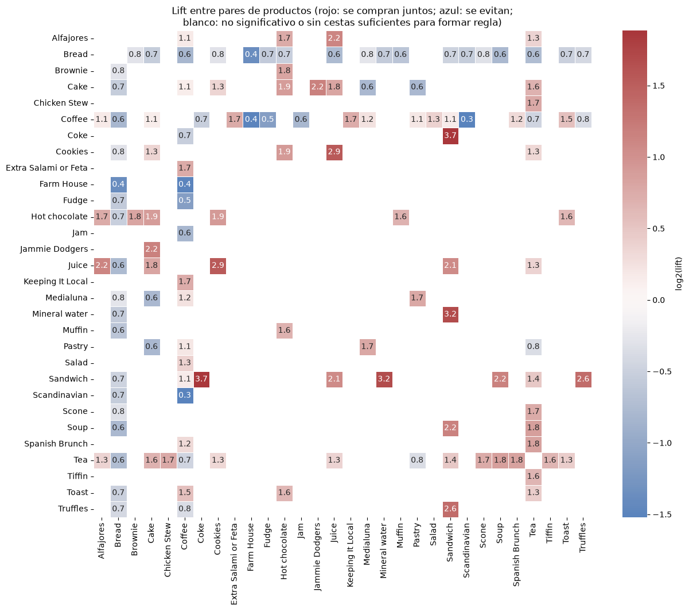
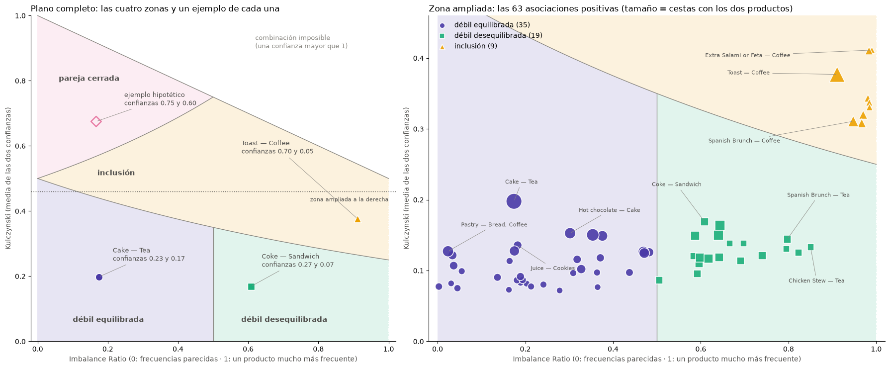
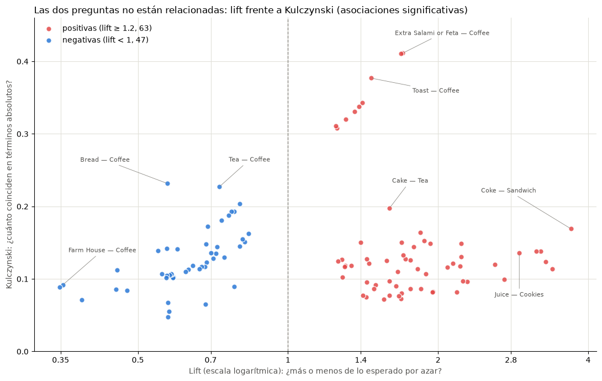
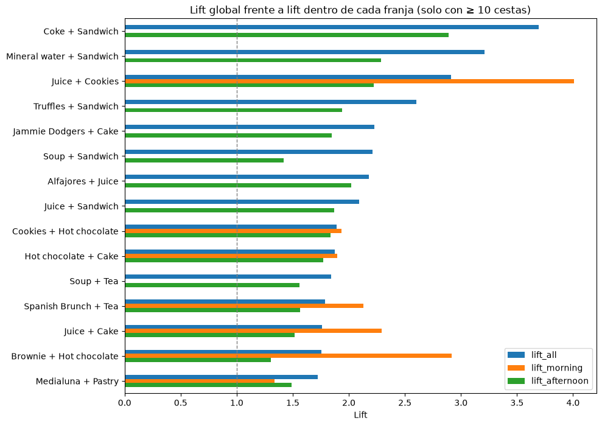
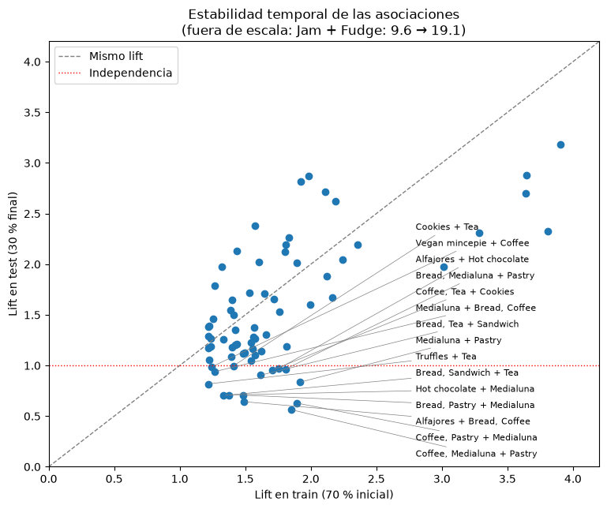

# Práctica PCD: Reglas de asociación en *The Bread Basket*

[](https://colab.research.google.com/github/ku2a/fp-growth/blob/main/main.ipynb)

Práctica de la asignatura PCD (Grado en Ciencia de Datos e Inteligencia Artificial, UPM). Comparamos tres algoritmos de minería de itemsets frecuentes (**Apriori**, **FP-Growth** y **ECLAT**) sobre los tickets de una panadería-cafetería y analizamos en profundidad las reglas que salen: significación estadística, forma de la relación, efecto de la franja horaria, asociaciones negativas y estabilidad en el tiempo.

Todo el trabajo está en [`main.ipynb`](main.ipynb). Este README resume el método y los resultados; los razonamientos completos y las tablas están en el notebook.

**Autores:** Álvaro Herrero Vidal y Pablo Suárez Iglesias (grupo G).

## Contenido

- [Estructura del repositorio](#estructura-del-repositorio)
- [Cómo ejecutarlo](#cómo-ejecutarlo)
- [Datos](#datos)
- [Metodología](#metodología)
- [Resultados](#resultados)
- [Limitaciones](#limitaciones)
- [Referencias](#referencias)

## Estructura del repositorio

| Ruta | Qué es |
| --- | --- |
| `main.ipynb` | Notebook de la práctica: EDA, preprocesado, benchmark de algoritmos y análisis de reglas. |
| `04_FP_Growth_251114.ipynb` | Notebook de ejemplo de la asignatura con FP-Growth sobre un dataset de juguete (material de partida). |
| `scripts/export_figures.py` | Extrae las figuras de este README de las salidas guardadas en `main.ipynb`. |
| `docs/img/` | Figuras usadas en este README. |
| `pyproject.toml`, `uv.lock` | Dependencias, gestionadas con [uv](https://docs.astral.sh/uv/). |
| `src/asociacion/` | Paquete vacío generado por `uv init`; no contiene lógica de la práctica. |

## Cómo ejecutarlo

### En local

Requiere Python ≥ 3.12 y `uv`.

```bash
uv sync                # crea .venv con las dependencias fijadas en uv.lock
uv run jupyter lab     # abre main.ipynb y ejecuta todas las celdas
```

### En Google Colab

Pulsa el botón *Open in Colab* de arriba y ejecuta todo. La primera celda instala `mlxtend==0.25.0` sin dependencias: la 0.23.4 que trae Colab tiene un FP-Growth unas 200 veces más lento, lo que falsearía la comparativa de tiempos. Si avisa de que ya estaba importada la versión antigua, reinicia el entorno y vuelve a ejecutarla. Los resultados son idénticos en local y en Colab.

### Dataset

El notebook busca `bread_basket.xls` (en realidad es un CSV) junto a él. Si no está, lo descarga automáticamente del dataset público [The Bread Basket](https://www.kaggle.com/datasets/mittalvasu95/the-bread-basket) de Kaggle, sin cuenta ni token. Si la descarga falla en Colab, abre un diálogo para subirlo a mano. El fichero está en `.gitignore`.

### Regenerar las figuras del README

Tras volver a ejecutar y **guardar** el notebook:

```bash
uv run python scripts/export_figures.py
```

## Datos

Tickets de una panadería-cafetería entre el 30-10-2016 y el 09-04-2017 (159 días, unas 60 compras al día). Cada fila es un artículo de un ticket, con fecha, momento del día (`morning`, `afternoon`, `evening`, `night`) y si era fin de semana.

| | Original | Tras preprocesar |
| --- | ---: | ---: |
| Filas | 20 507 | 18 835 |
| Transacciones (cestas) | 9 465 | 9 430 |
| Productos distintos | 94 | 90 |

**Preprocesado:** se eliminan los 1 619 artículos repetidos dentro de un mismo ticket, se limpian nombres con espacios al final y se quitan los registros que no son productos (`Adjustment`, `Gift voucher`, `Afternoon with the baker`, `Argentina Night`). Los tickets de un solo producto (el 41.7 %) se mantienen: no aportan co-ocurrencias, pero son compras reales y cuentan en el denominador del soporte.



La demanda está muy concentrada: el café aparece en el 48 % de los tickets y el pan en el 33 %, y solo 30 de los 94 productos llegan al 1 % de soporte. Esto condiciona todo el análisis: casi cualquier regla con café como consecuente tendrá una confianza alta aunque no aporte nada.

## Metodología

### 1. Algoritmos

- **Apriori** (Agrawal y Srikant, 1994): búsqueda por niveles, generando candidatos de tamaño *k + 1* a partir de los frecuentes de tamaño *k*.
- **FP-Growth** (Han, Pei y Yin, 2000): comprime las cestas en un árbol de prefijos y hace crecer los patrones sin generar candidatos.
- **ECLAT** (Zaki, 2000): formato vertical, búsqueda en profundidad intersecando los conjuntos de transacciones de cada producto. `mlxtend` no lo incluye, así que está implementado en el notebook (Python + máscaras booleanas de NumPy).

Apriori y FP-Growth vienen de `mlxtend`; las reglas se generan después con `association_rules`.

### 2. Benchmark

72 configuraciones: 3 algoritmos × 6 soportes mínimos (0.001–0.05) × 4 confianzas mínimas (0.1–0.7). Por cada algoritmo y soporte se hacen 7 ejecuciones para el tiempo (nos quedamos con el mínimo) y una más, aparte, para la memoria pico con `tracemalloc`.

Los tres algoritmos son exactos y el notebook lo comprueba: **generan exactamente las mismas reglas en las 24 combinaciones de umbrales**. Por tanto, lo único que los distingue es la eficiencia.

### 3. Análisis de reglas

- **Elección del soporte por validación** (Webb, 2007): con el 70 % inicial de las cestas (train), se descubren reglas en una parte de ajuste y se confirman con Fisher + Benjamini-Hochberg en otra de validación. Se elige el soporte con mayor tasa de confirmación.
- **Filtros:** lift ≥ 1.2 y test exacto de Fisher con corrección de Benjamini-Hochberg (q < 0.05). Bonferroni se usa solo para marcar las reglas más sólidas. La confianza mínima se deja a 0, porque favorece a los productos frecuentes (Brin, Motwani y Silverstein, 1997).
- **Forma de la relación:** Kulczynski e Imbalance Ratio (Wu, Chen y Han, 2010) para separar parejas cerradas, inclusiones y asociaciones débiles.
- **Complementariedad frente a coincidencia** (Manchanda, Ansari y Gupta, 1999): lift dentro de cada franja horaria.
- **Asociaciones negativas** (Savasere, Omiecinski y Navathe, 1998): reglas significativas con lift < 1.
- **Estabilidad temporal:** reglas de train (70 % inicial, hasta el 18-02-2017) contrastadas en test (30 % final).

## Resultados

### Eficiencia de los algoritmos



- **Apriori** es el más rápido con soportes medios y altos, pero el que más memoria usa (hasta 44 MB con soporte 0.001), porque genera y guarda candidatos.
- **FP-Growth** tiene un coste fijo alto que apenas depende del soporte.
- **ECLAT** usa muy poca memoria (< 0.25 MB), pero al ser Python puro es el más lento con soportes muy bajos.
- Generar las reglas cuesta pocos milisegundos en todos los casos: el coste está en la búsqueda de itemsets.

Los tiempos absolutos dependen de la máquina; lo que se mantiene es la forma de las curvas.

### Soporte mínimo elegido: 0.003



La tasa de confirmación en validación alcanza su máximo con **soporte 0.003** (64 %, 16 de 25 reglas), es decir, al menos 29 cestas por regla. Por debajo, muchas reglas se apoyan en tan pocas cestas que no se repiten con datos nuevos (22 % con 0.001); por encima no mejora y solo se pierden asociaciones. Con solo 1 980 cestas de validación, las diferencias pequeñas entre soportes están dentro del ruido.

**Algoritmo elegido: ECLAT.** Con soporte 0.003, FP-Growth queda dominado (más lento y con más memoria que ECLAT) y Apriori, aunque es el más rápido, usa unas 140 veces más memoria (21 MB frente a 0.15 MB). Al ser algoritmos exactos, el análisis posterior sería idéntico con cualquiera de los tres.

### Reglas obtenidas

Con soporte 0.003 salen 392 reglas, de las que **126 positivas** (lift ≥ 1.2) superan Fisher + BH. Como A → B y B → A tienen el mismo lift y p-valor, son **63 asociaciones distintas** (30 de ellas superan también Bonferroni). Además hay **47 asociaciones negativas** significativas.



Las asociaciones positivas forman "misiones de compra" (Sarantopoulos et al., 2016):

- **Menú de mediodía:** Coke + Sandwich (lift 3.69, la más fuerte del dataset), Mineral water + Sandwich (3.21), Truffles + Sandwich (2.60), Soup + Sandwich (2.21). El té se asocia con los platos calientes (Soup, Chicken Stew, Tiffin).
- **Bebida + dulce:** Juice + Cookies (2.91), Hot chocolate + Cake (1.88), Tea + Cake (1.60), Scone + Tea (1.69).
- **Desayuno:** Toast → Coffee (confianza 0.70), Extra Salami or Feta → Coffee (0.82), Medialuna + Pastry (1.72).

La fila de **Bread** es casi entera azul: el pan se compra menos de lo esperado con casi todo.

### Forma de la relación: Kulczynski e Imbalance Ratio



No hay ninguna **pareja cerrada** (Kulczynski máximo 0.41): ningún par de productos va "casi siempre junto". Hay 9 **inclusiones**, todas hacia el café (por ejemplo, Toast → Coffee: el 70 % de las tostadas van con café, pero solo el 5 % de los cafés van con tostada), y el resto son débiles: 35 equilibradas y 19 desequilibradas.

Las equilibradas sirven para packs o para colocar productos juntos; las inclusiones, para recomendación y promociones.



Lift y Kulczynski responden a preguntas distintas: Bread–Coffee coincide mucho en términos absolutos (Kulczynski 0.23) y aun así se compra junto menos de lo esperado (lift 0.57), mientras que Coke–Sandwich tiene el lift más alto con un Kulczynski de solo 0.17. La relación es exacta: Kulczynski = lift × popularidad media de los dos productos.

### Complementariedad frente a coincidencia



Dos productos que se venden en la misma franja horaria tienen lift > 1 aunque sean independientes dentro de ella (un efecto de la paradoja de Simpson). Al calcular el lift dentro de cada franja:

- **Soup + Sandwich** es en buena parte coincidencia: su lift baja de 2.21 a 1.42 dentro de la tarde, donde están 51 de sus 52 cestas.
- **Coke + Sandwich** es complementariedad real: mantiene un lift de 2.89 dentro de la tarde.
- **Brownie + Hot chocolate** depende mucho de la franja: 2.92 por la mañana y 1.30 por la tarde.

### Asociaciones negativas

35 de las 47 asociaciones negativas involucran al pan. Recogen dos fenómenos:

- **Sustitutos:** Farm House + Bread (lift 0.39), Pastry + Cake (0.58), Coffee + Tea (0.73).
- **Misiones de compra opuestas** (llevar a casa frente a consumir en el local): Bread + Coffee (852 cestas frente a 1 487 esperadas), y Scandinavian, Farm House, Fudge o Jam con Coffee.

La confianza no sirve para detectarlas: 14 de las 47 tienen confianza ≥ 0.25 y pasarían un filtro de confianza habitual.

### Estabilidad temporal



De las 75 asociaciones encontradas en train (lift ≥ 1.2), **58 siguen siendo positivas en test y 46 mantienen lift ≥ 1.2**. Las más estables son las del menú de mediodía (Coke + Sandwich, 3.90 → 3.19) y las de bebida + dulce (Hot chocolate + Cake, 1.81 → 2.19). Otras dependen del mes: Medialuna + Pastry cae de 1.92 a 0.84 porque el soporte mensual de Medialuna baja del 9 % en noviembre al 2 % en abril. Algunos productos solo se venden en parte del periodo (Keeping It Local, Spanish Brunch, Chicken Stew).

Es esperable que los lifts bajen algo en test, porque las reglas se eligieron por tener lift alto en train, y los lifts calculados sobre muy pocas cestas no son fiables (Jam + Fudge pasa de 9.64 a 19.05 con solo 2 cestas en test).

### Conclusiones

- Las asociaciones más fuertes responden a momentos de consumo, sobre todo el menú de mediodía.
- Para **packs y colocación** conviene usar las asociaciones equilibradas con más solapamiento (Cake + Tea, Sandwich + Tea); para **recomendación**, las desequilibradas (Coke → Sandwich).
- Productos con ventas modestas pero asociaciones fuertes (Cookies, Juice, Scone) son buenos candidatos para surtidos. Conviene no combinar pan, mermelada o fudge con productos de cafetería.
- Toda regla debe contrastarse con el contexto (franja horaria, mes) para no confundir coincidencia con complementariedad.

## Limitaciones

- Solo hay unos cinco meses de datos: no se puede distinguir si la caducidad de algunas reglas es estacional (recalcular una vez por época del año) o permanente (recalcular cada cierto tiempo).
- Las tasas de confirmación con las que se elige el soporte se calculan sobre 8–80 reglas y 1 980 cestas de validación; las diferencias pequeñas no son significativas.
- Las franjas `evening` y `night` tienen muy pocas cestas y quedan fuera del análisis por franja.
- Los tiempos del benchmark son de una sola máquina; ECLAT está en Python puro, por lo que su comparación con implementaciones vectorizadas no es del todo justa.

## Referencias

- Agrawal, R., y Srikant, R. (1994). Fast algorithms for mining association rules. *Proceedings of the 20th VLDB Conference*, 487–499.
- Benjamini, Y., y Hochberg, Y. (1995). Controlling the false discovery rate: A practical and powerful approach to multiple testing. *Journal of the Royal Statistical Society: Series B*, 57(1), 289–300.
- Brin, S., Motwani, R., y Silverstein, C. (1997). Beyond market baskets: Generalizing association rules to correlations. *Proceedings of ACM SIGMOD 1997*, 265–276.
- Han, J., Pei, J., y Yin, Y. (2000). Mining frequent patterns without candidate generation. *Proceedings of ACM SIGMOD 2000*, 1–12.
- Liu, B., Hsu, W., y Ma, Y. (1999). Mining association rules with multiple minimum supports. *Proceedings of the 5th ACM SIGKDD*, 337–341.
- Manchanda, P., Ansari, A., y Gupta, S. (1999). The "shopping basket": A model for multicategory purchase incidence decisions. *Marketing Science*, 18(2), 95–114.
- Sarantopoulos, P., Theotokis, A., Pramatari, K., y Doukidis, G. (2016). Shopping missions: An analytical method for the identification of shopper need states. *Journal of Business Research*, 69(3), 1043–1052.
- Savasere, A., Omiecinski, E., y Navathe, S. (1998). Mining for strong negative associations in a large database of customer transactions. *Proceedings of the 14th ICDE*, 494–502.
- Simpson, E. H. (1951). The interpretation of interaction in contingency tables. *Journal of the Royal Statistical Society: Series B*, 13(2), 238–241.
- Webb, G. I. (2007). Discovering significant patterns. *Machine Learning*, 68(1), 1–33.
- Wu, T., Chen, Y., y Han, J. (2010). Re-examination of interestingness measures in pattern mining: A unified framework. *Data Mining and Knowledge Discovery*, 21(3), 371–397.
- Zaki, M. J. (2000). Scalable algorithms for association mining. *IEEE Transactions on Knowledge and Data Engineering*, 12(3), 372–390.
